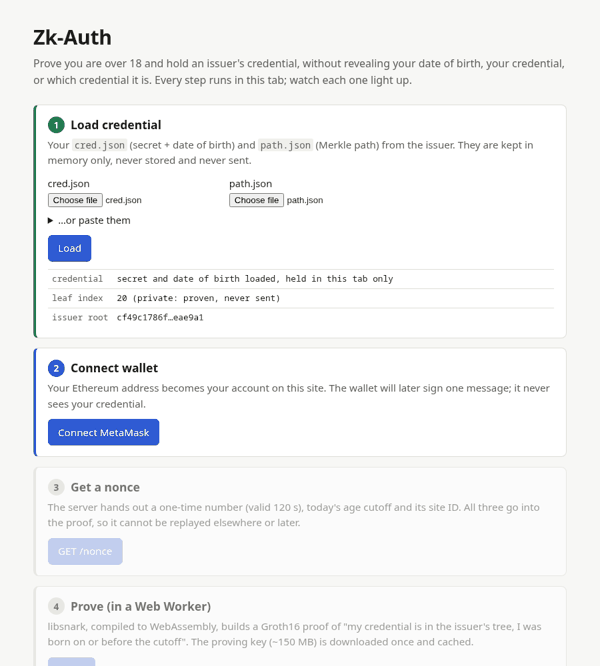

# Zk-Auth

**Log in by proving you are over 18, without telling the website your date of birth.**
Your browser runs libsnark, compiled to WebAssembly, to make a Groth16 zero-knowledge
proof that an issuer vouched for your age. A C++ (Crow) server verifies it, together with
a Sign-In with Ethereum signature, in about 3 ms of CPU time.



## What happens

```mermaid
flowchart LR
    subgraph Browser
        P[Page: steps 1–7] -->|credential, path, nonce| W[Web Worker<br/>wasm: libsnark + libff + GMP + OpenSSL]
        W -->|proof, public inputs, proof hash| P
        P <-->|personal_sign SIWE| M[MetaMask]
    end
    I[Issuer CLI<br/>zkauth-issuer] -. cred.json + path.json, once .-> P
    I -. roots.json .-> S
    P -->|GET /nonce, POST /login| N[nginx :8080<br/>client + proving key]
    N -->|/api/*| S[Crow server :8081<br/>Groth16 + secp256k1 verify,<br/>nonce/nullifier stores, Ed25519 JWT]
    B[Node baseline :8082<br/>Fastify + snarkjs + ethers] -.-|benchmarks| S
```

The website learns a Merkle root, a per-site nullifier, the age cutoff, a nonce, a proof and
a wallet signature. It never learns the date of birth, the credential secret, or which of
the issuer's credentials you hold. `tests/e2e/m6-login.mjs` captures every request the
page makes and checks exactly that.

## Quick start

Needs Docker with Compose v2, about 8 GB of free RAM for the first build, and a browser
with MetaMask.

```sh
git clone --recursive <this repository> zk-auth && cd zk-auth
docker compose up --build
```

The first start builds everything from source (C++ server, the WebAssembly prover with
GMP and OpenSSL, the Node baseline). That takes 20–40 minutes. Then the `init` service
runs the trusted setup (about 20 s) and issues a demo credential into `./demo/`.

1. Open **http://localhost:8080**.
2. Step 1: upload `demo/cred.json` and `demo/path.json`.
3. Step 2: connect MetaMask. Select **Ethereum Mainnet**: the server expects chain id 1.
   Nothing is sent to the chain, and signing costs nothing.
4. Steps 3–6: click through. Proving takes about 10 s; the 148 MB proving key downloads
   once and is cached.
5. Afterwards, try the **attack lab**: five broken logins, each rejected by the server
   check named on its badge.

The Node baseline listens on http://localhost:8082 (`/verify-proof`, `/verify-sig`).

`./demo.sh` does all of this in one command and then logs in once with headless
Chromium and a mock wallet. You need Node and Chromium for that last step, or set
`NO_HEADLESS=1`.

### Issue your own credential

```sh
docker compose run --rm init zkauth-issuer new  --state /data/issuer --dob 1999-12-31 --out /demo/my-cred.json
docker compose run --rm init zkauth-issuer root --state /data/issuer --roots-out /data/issuer/roots.json
docker compose run --rm init zkauth-issuer path --state /data/issuer --index 21 --out /demo/my-path.json
```

`new` prints the leaf index to pass to `path`. The server picks up the new root within
5 seconds. A date of birth less than 18 years ago gives a credential that cannot produce
a proof; the prover says so.

### Without Docker

Linux with GCC ≥ 13 (or Clang ≥ 17), CMake ≥ 3.25, Ninja, GMP and OpenSSL ≥ 3.2:

```sh
cmake --preset native-release && cmake --build --preset native-release
ctest --preset native-release                                   # 53 test cases
build/native-release/tools/zkauth-setup --out keys
build/native-release/tools/zkauth-issuer init --state data/issuer
build/native-release/tools/zkauth-issuer new  --state data/issuer --dob 2001-05-14 --out data/cred.json
build/native-release/tools/zkauth-issuer root --state data/issuer
build/native-release/tools/zkauth-issuer path --state data/issuer --index 20 --out data/path.json
prover-wasm/build-in-docker.sh                                  # wasm prover -> client/wasm/
build/native-release/server/zkauth-server --mode development    # :8081
```

Serve `client/` and `keys/` on one origin and proxy `/api/` to `:8081`, as
`docker/nginx.conf` does.

## Results

Measured on an AMD Ryzen 7 7700. Servers had 6 cores / 12 threads and the k6 load
generator 2 other cores; the median of 3 × 10 s runs is shown. Full method, all
tables and caveats are in **[docs/results.md](docs/results.md)**.

| | C++ (Crow, libsnark, OpenSSL) | Node (Fastify, snarkjs, ethers) | |
|---|---:|---:|---:|
| Groth16 verification, p50 | 2.30 ms | 6.73 ms | 2.9× |
| Signature recovery, p50 | 0.22 ms | 1.12 ms | 5.1× |
| `/verify-proof`, 64 connections, 12 threads / workers | **2,759 req/s** (p99 25 ms) | 1,141 req/s (p99 110 ms) | 2.4× |
| `/verify-sig`, 64 connections, 12 threads / workers | **28,768 req/s** (p99 5 ms) | 5,535 req/s (p99 22 ms) | 5.2× |
| Browser proving (Chrome Web Worker) | 10.4 s (native: 4.4 s) | | |


Every load-test response was checked against the expected verdict: 100% correct over
2.6 million requests. Both servers agree on 100 valid and 100 tampered proofs.

## Design decisions

* **Groth16 over BN254 with libsnark.** It gives the smallest proofs (3 points) and the
  fastest verification, and the curve is the one snarkjs and Ethereum use, so the Node
  baseline verifies the very same proofs.
* **The statement:** `H(secret, pad256(dob))` is in the issuer's Merkle tree,
  `nullifier = H(secret, site_id)`, and `dob ≤ age_cutoff`. H is the SHA-256
  compression function: 280,670 constraints in total
  ([how-it-works §4](docs/how-it-works.md#4-the-circuit-gadget-by-gadget)).
* **One build of libsnark for native and wasm** through a small CMake shim instead of
  libsnark's own CMake, which forces `-std=c++11 -march=native` and sets directory-scoped
  definitions that silently disagree with the code using it
  ([build-notes](docs/build-notes.md)).
* **OpenSSL in the browser too:** the wasm module computes the SIWE proof hash
  (SHA-256) and the EIP-55 address (Keccak-256) with the same OpenSSL release the
  server uses.
* **Check chain ordered by cost:** cheap string and hash-table checks, then the
  ~2 ms pairing check, then signature recovery. A nonce is consumed before anything
  else can fail, so it can't be used to probe the later checks
  ([§8](docs/how-it-works.md#8-the-servers-check-chain)).
* **Fail closed and say nothing:** strict parsers (exact keys, canonical hex, strict
  EIP-4361, on-curve and subgroup checks) and one generic 401. The failing check is
  named only in development mode.
* **Wallet signature over the proof hash:** binds proof, nonce and wallet, which makes
  Groth16's proof malleability harmless.
* **Cross-platform bugs found on the way, patched upstream-style and regression-tested:**
  a wasm32 `long` bug that made every browser proof invalid; a non-volatile inline-asm
  comparison that made libsnark's own verifier reject about 2/3 of valid proofs; and
  4× faster wasm field arithmetic ([§6](docs/how-it-works.md#6-how-the-browser-proves)).

## Limitations

A single-party trusted setup (demo only); one fully trusted issuer and no revocation;
an anonymity set of at most 256 credentials; a 148 MB proving key because SHA-256 is
expensive in a circuit; and in-memory server state. Each one, and what production
systems do instead, is in
[how-it-works §11](docs/how-it-works.md#11-limitations-and-what-production-systems-do-differently)
and the [threat model](docs/threat-model.md).

## Documentation

| | |
|---|---|
| [docs/how-it-works.md](docs/how-it-works.md) | the whole system for someone who has never used a SNARK: R1CS, Groth16, the circuit gadget by gadget, Merkle trees and nullifiers, the browser prover, Ethereum signatures with real numbers, the check chain, the attack lab, the benchmarks |
| [docs/formats.md](docs/formats.md) | every byte on the wire, with worked examples |
| [docs/threat-model.md](docs/threat-model.md) | 22 threats → the check that stops each → the test that proves it |
| [docs/results.md](docs/results.md) | benchmarks: machine, commands, method, all numbers |
| [docs/build-notes.md](docs/build-notes.md) | toolchains, pins, every patch to third-party code, milestone log |

## Tests

```sh
ctest --preset native-release        # 53 C++ test cases (circuit, proofs, formats, signatures, SIWE, stores, /login)
ctest --preset native-debug          # the same under ASan + UBSan
node tests/e2e/m6-login.mjs          # full browser login + PII-absence test (headless Chromium)
node tests/e2e/m7-attack-lab.mjs     # the five attacks, each caught by its check
node tests/e2e/wasm-consistency.mjs  # wasm prover vs native verifier
cmake --preset native-fuzz && cmake --build --preset native-fuzz && tests/fuzz/run.sh 600
```
