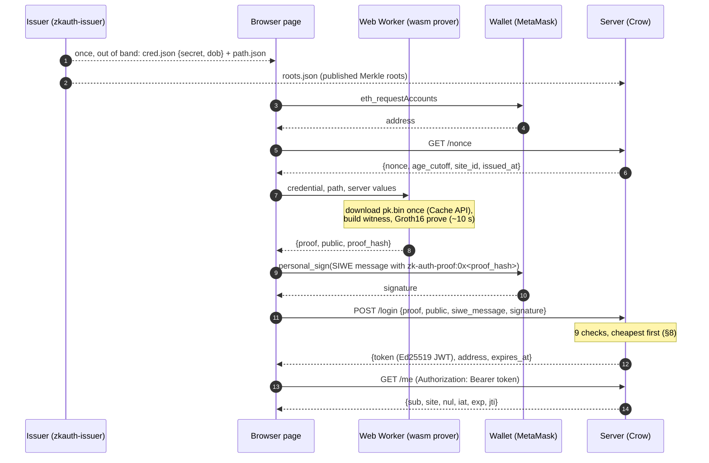

# How Zk-Auth works

This document is written for a computer-science student who knows C++ but has
never used a zero-knowledge proof. It is updated after every milestone. All
numbers and hex values are real outputs from this repository's test runs.

Contents:

1. [The problem](#1-the-problem)
2. [The login, end to end](#2-the-login-end-to-end)
3. [zk-SNARKs from zero](#3-zk-snarks-from-zero)
4. [The circuit, gadget by gadget](#4-the-circuit-gadget-by-gadget)
5. [Commitments, Merkle trees and nullifiers](#5-commitments-merkle-trees-and-nullifiers)
6. [How the browser proves](#6-how-the-browser-proves)
7. [Ethereum signatures and address recovery](#7-ethereum-signatures-and-address-recovery)
8. [The server's check chain](#8-the-servers-check-chain)
9. [The attack lab](#9-the-attack-lab)
10. [What the benchmarks show](#10-what-the-benchmarks-show)
11. [Limitations](#11-limitations)

---

## 1. The problem

A website that must only admit adults usually asks for a date of birth, or
worse, a scan of an ID. It then stores that personal data forever and becomes a
target for anyone who wants it. What the site actually needs is one bit: *is
this person over 18?* It also needs assurance that the bit came from someone
trustworthy rather than from the user typing a fake date. Zk-Auth gives the site
exactly that and nothing more. A trusted **issuer** (think: a government office
or a bank that has seen your ID) gives you a credential once. From then on your
browser produces a short mathematical proof that "the issuer vouched for a date
of birth that is at least 18 years ago, and I hold that credential". The site
verifies the proof in milliseconds and never sees the date, the credential, or
even *which* of the issuer's credentials you hold. It also proves that you
control an Ethereum wallet, which becomes your account identifier on the site.

## 2. The login, end to end



Only the arrows into the server carry data off the device. The `/login` body
has exactly four fields, and the PII-absence test captures it at the network
layer and checks that neither the secret nor the date of birth (as text, as a
day count, or as the hex used in the circuit) nor the Merkle path appears in
it or in any other request.

## 3. zk-SNARKs from zero

### Statements and witnesses

A zero-knowledge proof convinces a **verifier** that a **statement** is true
without revealing *why* it is true. The statement has two kinds of inputs:

* **public inputs**, which both sides know (in the toy example: `out = 35`);
* the **witness**, private values only the prover knows (the toy: `x = 3`).

The statement for the M1 risk spike is "I know an `x` with x³ + x + 5 = out".
The verifier learns that such an `x` exists and that the prover knows it.
Nothing else.

**zk-SNARK** stands for *zero-knowledge succinct non-interactive argument of
knowledge*. "Succinct" means the proof is tiny and quick to check. "Non-
interactive" means it is a single message, with no back-and-forth.

### From a program to R1CS

A SNARK cannot run C++. The statement must first be written as a **rank-1
constraint system (R1CS)**: a list of equations, each of the form

```
(linear combination) × (linear combination) = (linear combination)
```

over a vector of variables `z`. For the toy, `z = (1, out, x, x2, x3)` and the
constraints (see `core/toy_circuit.hpp`) are:

| # | A | × B | = C | with the witness z = (1, 35, 3, 9, 27) |
|---|---|---|---|---|
| 1 | x | x | x2 | 3 × 3 = 9 ✓ |
| 2 | x2 | x | x3 | 9 × 3 = 27 ✓ |
| 3 | x3 + x + 5 | 1 | out | 35 × 1 = 35 ✓ |

Every value lives in a prime field: arithmetic is modulo the 254-bit prime
`r = 21888242871839275222246405745257275088548364400416034343698204186575808495617`.
That is why everything in our formats is a 32-byte number. One multiplication
per constraint is the only primitive available. So anything non-arithmetic
(bits, comparisons, SHA-256) has to be built from many constraints, which is
why Zk-Auth's real circuit has about 280,000 of them.

### Why the proof is tiny and verification is fast

The prover turns the constraint list into polynomials (a **QAP**, quadratic
arithmetic program). "All constraints hold" then becomes "polynomial
`A(t)·B(t) − C(t)` is divisible by a known polynomial `Z(t)`". The prover
shows this divisibility at a single secret point `τ`. Nobody knows `τ`; it
exists only "in the exponent", baked into elliptic-curve points by the trusted
setup.

In **Groth16**, the proof system we use, a proof is exactly three curve points:

* `A` in G1, `B` in G2, `C` in G1 (BN254 / alt_bn128 curve).

That is 128 bytes compressed, or 256 bytes in our uncompressed JSON. The size
is the same for 3 constraints or 3 million. The verifier checks one equation
with a **pairing** `e(·,·)`, a bilinear map from G1 × G2 into a target group:

```
e(A, B) = e(α, β) · e(L, γ) · e(C, δ),     L = IC₀ + Σ publicᵢ · ICᵢ
```

Here `α, β, γ, δ` and the `ICᵢ` come from the verification key. The cost is three
pairings plus one small multi-scalar multiplication with one term per public
input. It does **not** depend on the circuit size. That is why the server can
verify a proof of a 280,000-constraint statement in about a millisecond.

The M1 browser proof for `x = 3` (from `build/m1/browser_proof.json`):

```json
{"a": {"x": "2880e9e8…6f3f", "y": "07f97f76…a4bb"},
 "b": {"x": ["256b7782…1b0e", "0017a8b5…b353"], "y": ["2c20b099…abf1", "0687cc40…6362"]},
 "c": {"x": "2de8adad…e046", "y": "2be941e4…4d7d"}}
public: ["00…0023"]   (0x23 = 35)
```

Changing the public input to 36 makes the native verifier answer `INVALID`.

### The trusted setup, and why it matters

Groth16 needs a one-time **setup** per circuit. It samples random secrets
(`τ, α, β, γ, δ`), publishes curve points derived from them as the **proving
key** and **verification key**, and must then destroy the secrets. These
secrets are called the "toxic waste". Anyone who kept them could forge proofs
of false statements, for example "I am over 18" without a credential. Our
`zkauth-setup` is a *single-party* setup and prints a warning saying so. It is
fine for a demo. In production, a multi-party ceremony (e.g. "powers of tau")
is used: many participants each add their own randomness, and the result is
safe as long as *one* of them destroyed their share.

### Where the "zero knowledge" comes from

The prover adds two fresh random field elements (`r`, `s`) to every proof. Two
proofs of the same statement therefore look unrelated, and a proof reveals
nothing about the witness. In the browser that randomness comes from
`crypto.getRandomValues()` (libff `random_element()` → `std::random_device` →
Emscripten `getentropy()`).

## 4. The circuit, gadget by gadget

`core/circuit.cpp` builds `ZkAuthCircuit` from libsnark's **gadgetlib1**.
A *gadget* is a C++ object that allocates variables on a shared
`protoboard` and adds the constraints for one sub-computation. It also knows
how to fill in (`generate_r1cs_witness`) the values that satisfy them. The
statement:

> I know `secret`, `dob` and a Merkle path such that
> `H(secret, pad256(dob))` is a leaf under `merkle_root`,
> `nullifier = H(secret, site_id)`, and `dob ≤ age_cutoff`.

Measured constraint counts (`zkauth-setup` prints this table):

| Constraints | Component | How it works |
|---:|---|---|
| 936 | public inputs: bits → 8 field elements | 928 booleanity constraints + 8 packing equations (below) |
| 736 | `secret` and `pad256(dob)` bits | 512 booleanity + 224 "this padding bit is 0" |
| 27,280 | `commitment = H(secret, pad256(dob))` | libsnark's SHA-256 compression gadget |
| 4,104 | Merkle path wires | 8 direction bits + 8 × 2 × 256 sibling bits, all boolean |
| 220,294 | Merkle membership | 8 × (H = 27,280 + selector 256) + 6 for root equality |
| 27,280 | `nullifier = H(secret, site_id)` | same gadget, output wires *are* the public nullifier wires |
| 40 | `dob ≤ age_cutoff` | 32-bit `comparison_gadget` + "result = 1" |
| **280,670** | **total** (255,817 variables, 8 public inputs) | ≈ 10 SHA-256 compressions × 27,280 = 272,800 + the rest |

**Booleanity.** A field element is not a bit. To force a variable `b` to be
0 or 1, the circuit adds `b · (1 − b) = 0`, whose only solutions are 0 and 1.
Every bit wire in the circuit has this constraint. Without it, a "bit" could
be 2 and the arithmetic below would silently mean something else.

**Packing.** The verifier's cost grows with the number of public inputs (one
scalar multiplication each). So the 928 public bits are not exposed one by
one: `multipacking_gadget` adds one constraint per field element,
`packed = Σ bitⱼ · 2ʲ`, with up to 253 bits per element (the largest power of
two that is safely below the 254-bit field size). A 256-bit digest therefore
becomes 2 elements, and the total is 2 + 2 + 2 + 1 + 1 = 8.

**SHA-256 inside a circuit.** SHA-256 works on 32-bit words with XOR, AND,
rotations and additions mod 2³². Rotations are free: they only re-wire bits.
XOR of bits `a, b` is the polynomial `a + b − 2ab` (one constraint), AND is
`ab`. An addition mod 2³² is done by adding the packed words as field elements
and then decomposing the sum back into 32 bits plus carries. 64 rounds of this
cost 27,280 constraints. That is why the circuit is "about ten SHA-256s".
Note that `H` is the *compression function* only: one block, no padding (see
[formats.md](formats.md#the-hash-h)).

**Selecting left or right.** At each Merkle level, the node computed so far
must go to the left or right input of the next hash, depending on a direction
bit `d`. `digest_selector_gadget` does this with one constraint per bit:
`(input − left) = d · (right − left)`. With `d = 0` it forces
`input = left`; with `d = 1`, `input = right`. That is 256 constraints per
level.

**The age check.** `comparison_gadget(n = 32)` computes `2³² + cutoff − dob`
and decomposes it into 33 bits; bit 32 is 1 exactly when `dob ≤ cutoff`. One
more constraint forces that bit to 1. The gadget is only sound if both inputs
are below 2³². `age_cutoff` gets that from its 32 boolean public bits, and
`dob` from the 224 constraints that force the top of `pad256(dob)` to zero.
Without them a prover could pick a `dob` around 2⁵⁰ that wraps around and
"compares" as small.

**What the circuit cannot do.** It cannot know today's date. Any
`age_cutoff` the prover picks is internally consistent (a 17-year-old can
prove `dob ≤ tomorrow`). It is the *server* that pins `age_cutoff` to its own
value (check 4 in §8). The test "a later cutoff is satisfiable, so the server
must pin age_cutoff" documents exactly this.

**The nonce** appears in no constraint at all. It is still bound to the proof.
Groth16's verification equation includes `Σ publicᵢ · ICᵢ`, and libsnark's
R1CS→QAP reduction adds a dummy constraint `inputᵢ · 0 = 0` for every input,
so every `ICᵢ` is a non-zero, independent point. Change the nonce and `L`
changes, so the pairing equation fails. `tests/test_proof.cpp` checks this
("wrong nonce"), along with the root, nullifier, site_id and cutoff. A
circuit-only test ("changing the nonce alone keeps the circuit satisfiable")
shows the constraints themselves do not care.

## 5. Commitments, Merkle trees and nullifiers

**Commitment.** The issuer cannot publish your date of birth, but it must
publish *something* the circuit can check against. It publishes
`commitment = H(secret, pad256(dob))`. Because `secret` is 256 random bits,
the commitment reveals nothing about `dob` (*hiding*: brute-forcing the ~40,000
plausible birthdays does not help without the secret). Because SHA-256's
compression function is collision resistant, you cannot later open it to a
different `dob` (*binding*).

**Merkle tree.** The issuer puts every commitment in a binary hash tree of
depth 8 (256 leaves) and publishes only the **root**. To prove "my commitment
is one of the leaves", you show the 8 sibling hashes on the path from your
leaf to the root. Inside the circuit those siblings are private, so the server
learns that *some* leaf matches, not which. The issuer pre-fills the tree with
20 dummy credentials, so even the first real user hides among 21 leaves.

**Nullifier.** Without one, a single credential could create unlimited
accounts, and a per-user ID (say, the commitment) would link the same person
across websites. The nullifier `H(secret, site_id)` is a *per-site
pseudonym*. On one site it is always the same, so the server can enforce
"one credential = one account". Different sites get unrelated values, because
without `secret` nobody can relate `H(secret, a)` to `H(secret, b)`.

Worked example, test fixture credential 0 (`zk_tests "[example]" -s`):

```
secret        1111111111111111111111111111111111111111111111111111111111111111
dob           2001-05-14 → 11456 days → pad256 = 00…002cc0
commitment    H(secret, pad256(dob))  = a55c6c30a851a0bc0bb0fb4dabb0314349a92fea91d40ec910e803efb1595163
leaf 1        faea4d98d908987850b08d3a3e25f4984426d1983e6c3d6ad04fb94692836374  (= siblings[0])
siblings[1]   ef615506b7e4fb53fbcabda0d7c11718e430a0c6ef108c8ff1aad6535377f60e  (= H(leaf 2, leaf 3))
root          7e9034f3dc1518c05f91667d3cea0b5d1e2c87d7b1358e8c9f4880127c918a08
site_id       5a5a…5a
nullifier     H(secret, site_id)      = 17f35bff1aac58f073d36556b4f794d1fd0715238ace48800b6c23b8168ae899
```

The real issuer flow (M3) produced, for a freshly issued credential at leaf 20
behind 20 dummies:

```
$ zkauth-issuer check --cred cred.json --path path.json --roots roots.json
commitment     9064f0eb222040fb7519776992ab79e0bc8f3c3ab7da2cd79df207d4a52e72bd
computed root  ec375622a18ae9ac48c36bafa71d55dc4f6886dfe03f34255bbdda0d43f03fd6
path root      ec375622a18ae9ac48c36bafa71d55dc4f6886dfe03f34255bbdda0d43f03fd6
root published: yes
OK: the credential's path verifies
```

What the issuer stores: only the commitments (`issuer.json`) and the roots it
has published (`roots.json`, which the server loads). Secrets and dates of
birth are written to the user's `cred.json` and then forgotten.

## 6. How the browser proves

### Compiling libsnark to WebAssembly

The prover is the same C++ code as the native tools. libsnark, its field and
curve library libff, and the big-number library GMP are compiled with
Emscripten into one `.wasm` module (`prover-wasm/`). The steps that make this
work, and the three small patches it needed, are in
[build-notes.md](build-notes.md). The one surprising detail is that the native
build uses 64-bit limbs and the browser 32-bit ones, yet the proving key file
is byte-for-byte compatible (explained in build-notes).

### The Web Worker

Proving takes seconds and would freeze the page if it ran on the main thread.
`client/*-worker.js` loads the wasm module inside a **Web Worker**. The page
sends it the inputs with `postMessage` and receives a JSON proof back. The M1
check confirms the proof really was made in a `DedicatedWorkerGlobalScope`.

### What is in the proving key, and why it is big

The proving key is 148.5 MB (see the table in
[formats.md](formats.md#keys)). Most of it is curve points, one or two per
circuit variable, which the prover combines with the witness values in large
**multi-scalar multiplications**. 65 MB of it is the R1CS itself, which the
prover needs to compute the quotient polynomial `h(x)`.

`client/worker.js` downloads it once with a progress bar and stores it in the
browser's **Cache API** under a URL containing its SHA-256 (from
`keys/manifest.json`). A new trusted setup therefore invalidates the cached
copy automatically. Every load is checked against that hash before it
reaches the prover. Parsing the 148.5 MB into libsnark objects takes about
0.44 s, and the parsed key then stays in the worker's wasm memory for further
proofs.

### What the prover actually does, and where the time goes

A Groth16 proof is three curve points built from the witness `w` (all 255,817
wire values):

1. **Witness** (0.4 s in the browser): run the circuit's
   `generate_r1cs_witness`, i.e. evaluate 10 SHA-256 compressions bit by bit.
2. **Quotient polynomial `h(x)`** (3.4 s): interpolate the constraint
   polynomials `A·w, B·w, C·w` over an evaluation domain of 2¹⁸ + 2¹⁵ points
   and divide by the vanishing polynomial. This is about seven FFTs over Fr.
3. **Multi-scalar multiplications** (6.2 s): `Σ wᵢ·Aᵢ`, `Σ wᵢ·Bᵢ` (in G2),
   `Σ hᵢ·Hᵢ`, `Σ wᵢ·Lᵢ`. Most `wᵢ` are bits, so libsnark skips the zeros
   and adds the ones directly (about 98% of A/L entries). The `H` sum has
   294,911 full 254-bit scalars and dominates (5.5 s, bucketed Pippenger
   method).
4. **Blinding**: add `r·δ` and `s·δ` with fresh random `r, s`. This is what
   makes the proof zero-knowledge.

Measured in Chrome 156: **10.3–10.5 s**, against 4.4 s for the same code
natively.

### Two bugs that only appeared in the browser, and what they teach

* **`long` is not 64 bits everywhere.** libsnark stored SHA-256's round
  constants in a `long`. On wasm32 `long` is 32 bits, so half the constants
  became negative field elements. The browser's circuit was self-consistent
  and even produced correct hashes (the error cancels modulo 2³²), but its
  coefficients no longer matched the constraint system inside the proving key.
  So every proof was invalid. The tool that found it compares the two
  constraint systems directly: they diverged at constraint 9,922 of 280,670.
* **Inline asm is a contract with the compiler.** The *native verifier*
  rejected about 2/3 of valid proofs. libff sorts public-input scalars in a
  heap with an x86-64 asm comparison that was not `volatile` and did not say
  it reads memory, so GCC 16 at `-O3` reused stale comparison results. The
  browser (no asm) was right and the server was wrong. The lesson: a verifier
  needs randomised tests too. Fixed-value tests had passed for weeks of
  upstream history.

### Making WebAssembly fast enough

The first browser measurement was 42.4 s, 9.6× native in *every* phase.
Uniform slowness points at the innermost primitive, the 256-bit modular
multiplication. Natively, libff uses hand-written x86-64 assembly. In wasm it
fell back to generic code that makes about 20 calls into GMP per
multiplication. `fp_wasm32.tcc` (patch libff-0003) writes the same Montgomery
multiplication (the CIOS variant) as straight-line C++ over 8 × 32-bit limbs
with 64-bit accumulators. The browser executes those as native `i64.mul`, so
proving dropped to 10.4 s. Correctness is checked against an independent
big-integer reference (1.2 M random operations) and by verifying browser
proofs natively.

## 7. Ethereum signatures and address recovery

The zk proof says *"some adult holds a credential"*. The signature adds *"and
it is the owner of wallet 0x…"*, and the login binds the two together. All of
it is done with OpenSSL in `server/eth_sig.cpp`; no Ethereum library is
involved.

**Keys and addresses.** An Ethereum account is a secp256k1 key pair: a
private scalar `d` and the public point `Q = d·G`. The *address* is the last
20 bytes of `keccak256(X ‖ Y)`, the hash of the 64-byte uncompressed point.
Keccak-256 is the pre-standard version of SHA-3 with a different padding
byte. OpenSSL calls it `KECCAK-256` (available since 3.2) and it is **not**
`SHA3-256`; a test checks that the two differ on the empty string. Addresses
are usually written in EIP-55 mixed case, where the case of each letter
encodes one bit of `keccak256(lowercase hex)`. This is a typo detector, and
the parser rejects a mixed-case address whose case is wrong.

**What MetaMask signs.** `personal_sign` never signs your text directly. It
signs `keccak256("\x19Ethereum Signed Message:\n" + len + text)` (EIP-191).
The `\x19` prefix guarantees the bytes can never be a valid Ethereum
transaction, so a login signature cannot be replayed as a payment. Note that
`len` counts UTF-8 *bytes*; one of the vectors uses `"Grüße, 世界 — ✓"` to
check that.

**Recovering the signer instead of looking it up.** An ECDSA signature is
`(r, s)`. `r` is the x-coordinate of a random point `R = k·G`, and
`s = k⁻¹(e + r·d) mod n`, where `e` is the digest. Rearranging gives
`Q = r⁻¹(s·R − e·G)`. So from `(r, s)` and the digest we can *recompute* the
public key, provided we know which of the two points with x = r was `R`. That
one bit is `v` (27 → even y, 28 → odd y). The server therefore needs no key
registry: it recovers `Q`, hashes it to an address, and compares that with
the address in the SIWE message.

Step by step with real numbers (the vector from MetaMask's eth-sig-util:
key `4af1…8bb0` signs `Hello, world!`; test `[example]`):

```
signed bytes  "\x19Ethereum Signed Message:\n13Hello, world!"
digest e      b453bd4e271eed985cbab8231da609c4ce0a9cf1f763b6c1594e76315510e0f1
r             90a938f7457df6e8f741264c32697fc52f9a8f867c52dd70713d9d2d472f2e41
s             5d9c94148991bbe1f4a1818d1dff09165782749c877f5cf1eff4ef126e55714d
v             28  → R = the point with x = r and odd y
Q = r⁻¹(sR−eG) 9e9e45b2…dc5acd79 ‖ d0dfeea9…9478903a        (X ‖ Y, 64 bytes)
keccak256(Q)  ba8ee2251943767535685e5f 29c76e6ad8f28bb1004902578fb108c507be341b
address       0x29C76e6aD8f28BB1004902578Fb108c507Be341b   (last 20 bytes, EIP-55 cased)
```

In OpenSSL: `EC_POINT_set_compressed_coordinates(group, R, r, v & 1)` builds
`R` and fails if `r` is not an x-coordinate on the curve. Then a single
`EC_POINT_mul(group, Q, u1, R, u2)` computes `u1·G + u2·R` with
`u1 = −e·r⁻¹`, `u2 = s·r⁻¹ (mod n)`.

**What gets rejected, and why** (each is a test in `tests/test_eth_sig.cpp`):

| Check | Attack it stops |
|---|---|
| `r, s ∈ [1, n−1]` | garbage that is not an ECDSA signature at all |
| `s ≤ n/2` (EIP-2 low-s) | malleability: `(r, n−s)` with flipped `v` is a *second* valid encoding of the same signature |
| `v ∈ {27, 28}` (or 0/1) | recovery ids 2/3 (`r ≥ n` cases) never produced by wallets |
| `r` must be on the curve | crafted `r` with no point |
| `Q ≠ ∞` | crafted `(r, s)` that "recover" the point at infinity |
| recovered address == SIWE address | anyone else's signature |

The implementation is cross-checked against bitcoin-core's libsecp256k1 (the
library Bitcoin runs on): 10,000 random keys sign random messages there, and
`server/eth_sig.cpp` recovers the same address every time, in both the 27/28
and 0/1 forms of `v`.

**SIWE (EIP-4361)** turns "sign this hash" into a human-readable message the
wallet shows the user:

```
localhost:8080 wants you to sign in with your Ethereum account:
0xFCAd0B19bB29D4674531d6f115237E16AfCE377c

Log in to Zk-Auth. zk-auth-proof:0x<sha256 of the proof and public inputs>

URI: http://localhost:8080
Version: 1
Chain ID: 1
Nonce: 0f0f0f0f0f0f0f0f0f0f0f0f0f0f0f0f
Issued At: 2026-10-27T12:00:00.000Z
```

`server/siwe.cpp` parses this grammar strictly: exact line structure, no CR,
no trailing newline, fields in order, EIP-55 address, nonce ≥ 8 alphanumeric
characters, RFC 3339 times. Anything looser could let the server interpret a
message differently from what the wallet displayed to the user.

## 8. The server's check chain

`AuthService::login` (`server/routes.cpp`) runs these checks in this order.
Any failure answers `401 {"error":"authentication failed"}`. The precise
reason goes only to the server log, and in development mode to an
`X-ZkAuth-Reject` header, which the attack lab displays.

| # | Check | Cost | Stops |
|---|---|---|---|
| 1 | body ≤ 16 KB, JSON with exactly 4 fields, points on curve and in subgroup, `packed` == recomputation | µs | junk, invalid-curve points, mismatched public inputs |
| 2 | nonce exists, unexpired, **removed atomically** | µs (one mutex) | replay of a captured request |
| 3 | SIWE: domain, URI, chain, issued-at ≤ 5 min old, nonce = proof's nonce, statement commits to `sha256(proof ‖ public)` | µs | phishing (signed for another site), stale signatures, swapping in another proof |
| 4 | `site_id` and `age_cutoff` equal the server's own values | ns | proofs made for another site; an under-18 holder proving `dob ≤ <later date>` |
| 5 | `merkle_root` ∈ published roots | ns | a tree the attacker built themselves |
| 6 | Groth16 verification with the processed vk | ~1 ms | everything about the credential |
| 7 | signer recovered from the signature == SIWE address | ~0.1 ms | someone else's wallet |
| 8 | nullifier unseen, or bound to the same address | µs | one credential opening several accounts |
| 9 | issue the token | µs | — |

**Why this order?** Rejecting junk should cost less than accepting a real
login, or a flood of garbage becomes a denial-of-service attack. The pairing
check (6) is by far the most expensive step, so everything that can be
checked with a hash-table lookup or a string comparison runs first. Within
that, the nonce (2) is consumed before anything that depends on secret-free
but attacker-chosen data (3–8). A failed attempt therefore burns the nonce:
an attacker cannot reuse one nonce to probe the later checks again and
again. The nullifier (8) is bound only after both cryptographic checks pass.
Otherwise someone could "squat" a victim's nullifier with an invalid proof.

**Why is the nonce stored with its age cutoff?** If the date changes between
`GET /nonce` and `POST /login`, "today minus 18 years" changes too. The
server remembers which cutoff it handed out with each nonce and checks
against that, so a login across midnight UTC does not fail spuriously.

**Thread safety.** Crow runs one handler per worker thread. Nonces and
nullifiers live in 64-way sharded hash maps (one mutex per shard), and the
known roots are an immutable set swapped atomically when `roots.json`
changes. OpenSSL contexts (Keccak, secp256k1) are per thread
(`thread_local`). The processed verification key is read-only, and libff's
profiling globals are disabled before any thread starts.

## 9. The attack lab

*(Written at M7.)*

## 10. What the benchmarks show

*(Written at M8.)*

## 11. Limitations

*(Completed at M9.)* Already known: the trusted setup is single-party (§3).
