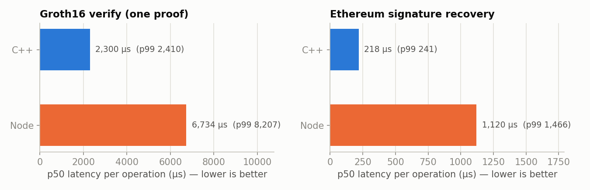
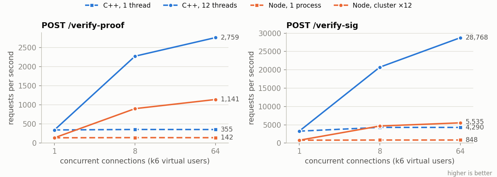
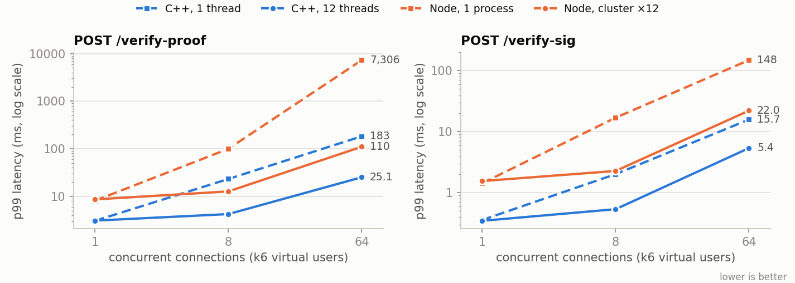
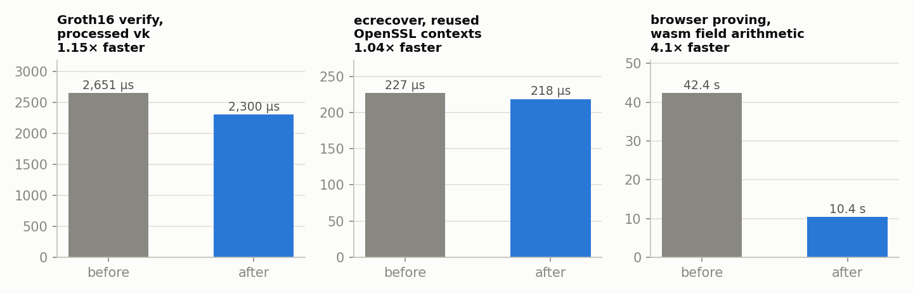

# Results

Every number here was measured on the machine below by the commands below.
Nothing is estimated or rounded up; where a number has a caveat, the caveat
is next to it.

## Machine, versions, commands

| | |
|---|---|
| CPU | AMD Ryzen 7 7700, 8 cores / 16 threads (SMT), boost on, `powersave` governor (amd-pstate) |
| RAM | 31.9 GB (a desktop with other applications running: ~23 GB in use during the runs) |
| OS | Arch Linux, kernel 7.2.6 |
| C++ | GCC 16.2.1, `-O3` (CMake Release), OpenSSL 3.6.4, GMP 6.3.0, libsnark `27993768` + patches, Crow 1.3.3, Asio 1.36.0 |
| Node | v24.22.1 LTS in `node:24-bookworm-slim@sha256:55fb5f5a…` (host networking), Fastify 5.12.7, snarkjs 0.7.6, ffjavascript 0.3.1, ethers 6.17.0 |
| Load generator | k6 v2.3.0 (`grafana/k6@sha256:3e4186ae…`, host networking) |
| Browser | Chromium 156 (headless), Emscripten 6.0.13 |

```sh
cmake --preset native-release && cmake --build --preset native-release
build/native-release/tools/zkauth-setup --out keys
build/native-release/bench/zkauth-bench-fixtures --pk keys/pk.bin --out build/bench-fixtures --threads 6
# micro-benchmarks, each pinned to one physical core (CPUs 2 and 10)
taskset -c 2,10 build/native-release/bench/zkauth-microbench --fixtures build/bench-fixtures --vk keys/vk.bin \
    --benchmark_out=build/bench-results/micro_cpp.json --benchmark_out_format=json
node baseline-node/convert.mjs keys/vk.json > build/bench-results/verification_key.json
docker run --rm --cpuset-cpus 2,10 -v $PWD/baseline-node:/app -v $PWD/build/bench-fixtures:/fix \
    -v $PWD/build/bench-results:/res -w /app node:24-bookworm-slim@sha256:55fb5f5a… \
    sh -c 'node microbench.mjs /fix /res/verification_key.json > /res/micro_node.json'
# load tests, then the converter cross-check, then tables and charts
bench/run_load.sh build/bench-fixtures build/bench-results
CPP=http://127.0.0.1:8081 NODE=http://127.0.0.1:8082 node baseline-node/check-converter.mjs build/bench-fixtures
build/venv/bin/python bench/aggregate.py build/bench-results docs/img
```

## Method

* **Fixtures** (`bench/gen_fixtures.cpp`): 1,000 valid proofs from 200
  different credentials (behind 20 dummies), each with a fresh random
  nonce, plus 100 invalid but well-formed ones (proof moved to another
  nonce, C negated, A/C swapped). Also 1,000 valid `personal_sign`
  signatures over SIWE-sized messages from 1,000 random libsecp256k1 keys,
  plus 100 that claim the wrong signer. That is a 10% invalid mix for both.
* **Both servers do the same job:** same JSON requests, same status codes,
  and the same strict validation. The Node baseline recomputes the packed
  public inputs from the named fields, exactly like the C++ server. The
  C++ server additionally checks G2 subgroup membership of proof point B;
  ffjavascript's `isValid` only checks the curve equation. So C++ does
  *more* work per proof.
* **Fair Node configuration:** the baseline verifies with snarkjs's own
  algorithm (`groth16_verify.js`: one 4-pair multi-pairing), but builds the
  curve and parses the verification key once, at start-up. The plain
  `snarkjs.groth16.verify` call is 41% slower (below), so the comparison
  uses the faster Node variant.
* **Converter correctness** (`baseline-node/check-converter.mjs`): the first
  100 valid and 100 tampered fixture proofs were sent to both servers.
  Result: `{"valid": {"cpp": 100, "node": 100}, "tampered": {"cpp": 100, "node": 100}, "disagreements": 0}`.
* **Micro-benchmarks:** one operation per sample, after warm-up. C++ uses Google
  Benchmark with `Iterations(1)` × 1,000–3,000 repetitions and p50/p99 over
  the repetitions; Node uses a `process.hrtime` loop. Both are pinned to the
  same single physical core.
* **Load:** servers pinned to physical cores 0–5 (12 hardware threads); k6
  pinned to cores 6–7 (4 hardware threads); no core shared. Configurations:
  Crow with 1 and with 12 worker threads; Fastify as a single process and as
  a `node:cluster` of 12 workers. For each endpoint and for 1, 8 and 64 k6
  virtual users (closed-loop connections): a 5 s warm-up, then 3 × 10 s.
  The tables show the **median** of the 3 runs. k6 checks every response's
  verdict against the fixture's expected one: *correct verdicts* was 100.00%
  in every cell (2,612,284 measured requests, warm-ups not counted).

## Micro-benchmarks



| Implementation | Operation | p50 | p99 | mean |
|---|---|---:|---:|---:|
| C++ | `ecrecover/reused_contexts` | 218.5 | 240.8 | 219.3 |
| C++ | `ecrecover/fresh_contexts` | 226.9 | 250.4 | 227.8 |
| Node | `ecrecover/ethers_verifyMessage` | 1,120.1 | 1,465.9 | 1,134.2 |
| C++ | `endpoint/verify_proof` | 2,792.7 | 2,883.8 | 2,795.3 |
| C++ | `endpoint/verify_sig` | 224.2 | 245.8 | 224.9 |
| Node | `endpoint/verify_proof` | 6,695.6 | 10,554.1 | 6,902.9 |
| C++ | `groth16_verify/processed_vk` | 2,300.1 | 2,409.7 | 2,302.6 |
| C++ | `groth16_verify/unprocessed_vk` | 2,651.4 | 2,755.2 | 2,652.6 |
| Node | `groth16_verify/cached_curve` | 6,733.9 | 8,207.2 | 6,879.6 |
| Node | `groth16_verify/snarkjs_default` | 9,498.9 | 14,365.7 | 9,784.8 |
| C++ | `proof_json_parse` | 479.3 | 494.7 | 479.2 |

`endpoint/*` is the whole request handler minus HTTP: JSON parsing,
validation, and verification. On the C++ side, 479 µs of the 2,793 µs
`/verify-proof` cost is parsing, mostly the G2 subgroup check
(`r·P = 0`, a 254-bit scalar multiplication in G2).

## Load tests





### Load: POST /verify-proof (median of 3 × 10 s runs)

| Config | VUs | req/s | p50 ms | p99 ms | max ms | correct verdicts | requests |
|---|---:|---:|---:|---:|---:|---:|---:|
| cpp-1 | 1 | 344 | 2.84 | 3.05 | 3.5 | 100.00% | 10,323 |
| cpp-1 | 8 | 357 | 22.32 | 23.15 | 24.4 | 100.00% | 10,719 |
| cpp-1 | 64 | 355 | 179.54 | 182.72 | 282.4 | 100.00% | 10,847 |
| cpp-12 | 1 | 344 | 2.84 | 3.08 | 3.6 | 100.00% | 10,312 |
| cpp-12 | 8 | 2,272 | 3.04 | 4.23 | 6.8 | 100.00% | 68,124 |
| cpp-12 | 64 | 2,759 | 24.59 | 25.14 | 36.4 | 100.00% | 82,969 |
| node-1 | 1 | 140 | 6.92 | 8.11 | 9.3 | 100.00% | 4,184 |
| node-1 | 8 | 144 | 47.82 | 99.73 | 108.3 | 100.00% | 4,323 |
| node-1 | 64 | 142 | 292.62 | 7306.10 | 10427.8 | 100.00% | 4,466 |
| node-12 | 1 | 138 | 6.94 | 8.61 | 14.6 | 100.00% | 4,152 |
| node-12 | 8 | 901 | 8.70 | 12.68 | 14.8 | 100.00% | 27,064 |
| node-12 | 64 | 1,141 | 49.95 | 110.08 | 159.2 | 100.00% | 34,434 |

### Load: POST /verify-sig (median of 3 × 10 s runs)

| Config | VUs | req/s | p50 ms | p99 ms | max ms | correct verdicts | requests |
|---|---:|---:|---:|---:|---:|---:|---:|
| cpp-1 | 1 | 3,262 | 0.26 | 0.36 | 0.7 | 100.00% | 97,845 |
| cpp-1 | 8 | 4,293 | 1.81 | 2.01 | 2.7 | 100.00% | 128,667 |
| cpp-1 | 64 | 4,290 | 14.86 | 15.74 | 19.5 | 100.00% | 129,024 |
| cpp-12 | 1 | 3,261 | 0.27 | 0.35 | 0.8 | 100.00% | 97,640 |
| cpp-12 | 8 | 20,719 | 0.37 | 0.54 | 2.2 | 100.00% | 620,688 |
| cpp-12 | 64 | 28,768 | 2.30 | 5.37 | 16.6 | 100.00% | 862,676 |
| node-1 | 1 | 799 | 1.20 | 1.43 | 2.1 | 100.00% | 23,935 |
| node-1 | 8 | 842 | 8.28 | 16.91 | 19.4 | 100.00% | 25,304 |
| node-1 | 64 | 848 | 74.22 | 148.24 | 1989.9 | 100.00% | 25,567 |
| node-12 | 1 | 783 | 1.22 | 1.55 | 16.6 | 100.00% | 23,522 |
| node-12 | 8 | 4,671 | 1.41 | 2.27 | 4.4 | 100.00% | 140,023 |
| node-12 | 64 | 5,535 | 10.65 | 22.02 | 41.3 | 100.00% | 165,476 |

At 1 connection, Crow's 1-thread and 12-thread configurations are identical
(one request at a time). The single-process Node server at 64 connections
queues requests behind one event loop: its p99 reaches 7.3 s, but every
response was still correct.

**Caveat:** at 28,768 req/s (`/verify-sig`, Crow, 12 threads, 64 VUs) the load
generator, running on only 4 hardware threads, may itself be close to
saturation. Treat that cell as a lower bound for the server.

## Optimisation experiments



| Experiment | Before | After | Change | Where measured |
|---|---:|---:|---:|---|
| Groth16: processed verification key (G2 line precomputation for γ, δ done once at start-up) vs processed on every request | 2,651 µs | 2,300 µs | 1.15× faster | micro, p50 |
| Signature recovery: OpenSSL objects (`EVP_MD` for KECCAK-256, `EVP_MD_CTX`, `EC_GROUP`, `BN_CTX`) reused per thread vs created per request | 227 µs | 218 µs | 1.04× faster (small: OpenSSL makes these cheaply) | micro, p50 |
| Crow worker threads: 1 → 12 (6 physical cores) | 355 / 4,290 req/s | 2,759 / 28,768 req/s | 7.8× / 6.7× | load, `/verify-proof` / `/verify-sig`, 64 VUs |
| Browser prover: call-free 8 × 32-bit Montgomery arithmetic in wasm (patch libff-0003) vs libff's generic GMP path | 42.4 s | 10.4 s | 4.1× faster | Chrome 156 Web Worker, one proof |
| (Node) `snarkjs.groth16.verify` → curve and vk built once, single-threaded engine | 9,499 µs | 6,734 µs | 1.41× faster | micro, p50 |

## The zk side

| | |
|---|---|
| Circuit | 280,670 constraints, 255,817 variables, 8 public inputs (≈ 10 SHA-256 compressions) |
| Trusted setup (native, 1 thread) | 15.0 s |
| Proving key / verification key | 148,499,473 B (65.0 MB of it the R1CS) / 1,249 B |
| Native proving (1 thread) | 4.42–4.57 s |
| Browser proving, Chrome 156 Web Worker | **10.3–10.5 s** (before the wasm optimisation: 42.4 s); witness 0.40 s; key parse 0.44 s |
| `zkauth_prover.wasm` | 2,548,838 B (libsnark + libff + GMP + OpenSSL libcrypto) |
| Full browser login (6 steps, headless, key cached in memory) | 13.1 s, of which 10.6 s is proving |
| Proof size on the wire | 3 points, 256 B of coordinates; 583 B as hex JSON (whole `/verify-proof` body: 1,455 B) |

## Verdict on the two claims

**Claim 1:** *"Architected a Crow-based backend to verify zk-SNARK proofs and
Ethereum signatures, optimizing verification throughput compared to standard
Node.js implementations."*
**True as measured.** On the same 12 hardware threads, the Crow server
sustains 2.4× the proof-verification throughput of a Fastify + snarkjs
cluster (2,759 vs 1,141 req/s at 64 connections) and 5.2× the
signature-verification throughput of Fastify + ethers (28,768 vs 5,535
req/s). Single-threaded the ratios are 2.5× and 5.1×. The p99 latency is
lower in every multi-threaded cell. This holds even though the C++ server
does the stricter validation (G2 subgroup check) and Node ran in its
fastest configuration. A more precise wording backed by these numbers:
*"Built a multithreaded Crow (C++) backend that verifies Groth16 proofs and
Ethereum signatures at 2.4× and 5.2× the throughput of a Node.js (Fastify +
snarkjs + ethers) baseline on identical hardware."*

**Claim 2:** *"Engineered a zero-trust authentication protocol by compiling C++
primitives (OpenSSL, libsnark) to WebAssembly, enabling secure client-side
proof generation without exposing PII."*
**True in substance; "zero-trust" overstates it.** libsnark (with libff and
GMP) and OpenSSL's libcrypto are compiled to WebAssembly. Proofs are
generated in a browser Web Worker in ~10.4 s, and the PII-absence test shows
the date of birth and credential secret never leave the browser. But the
protocol *does* trust two parties: the credential issuer and the
(single-party, demo) trusted setup. Suggested wording: *"Designed a
privacy-preserving login protocol (Groth16 zk-SNARK + Sign-In with
Ethereum) by compiling libsnark and OpenSSL to WebAssembly: users prove
they are over 18 in the browser (~10 s) and the server never receives their
date of birth."*
